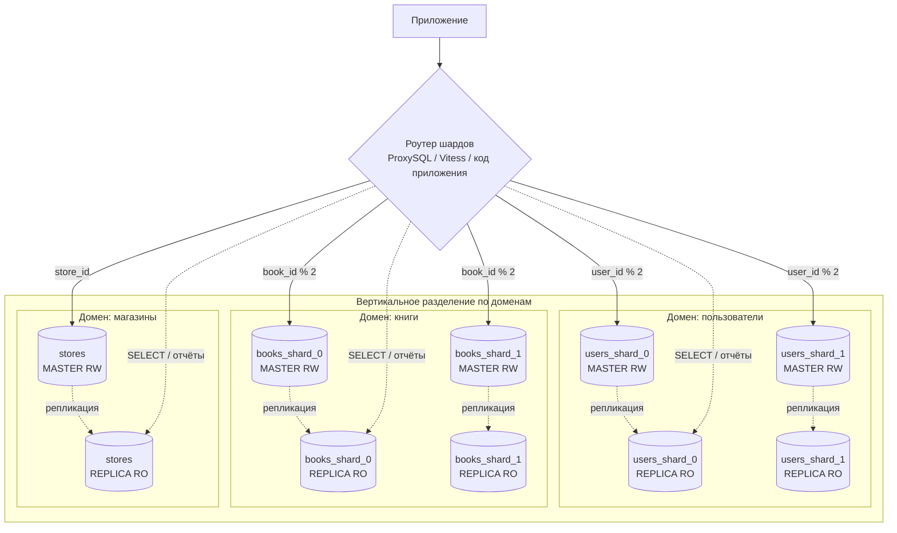

# Домашнее задание к занятию «Репликация и масштабирование. Часть 2»

**Выполнил:** Haujs

---

### Задание 1

Опишите основные преимущества использования масштабирования методами:

- активный master-сервер и пассивный репликационный slave-сервер;
- master-сервер и несколько slave-серверов.

**Решение.**

**1. Активный master + пассивный slave (hot standby)**

- **Отказоустойчивость.** Slave хранит полную копию данных. При отказе master его можно повысить до роли master (failover) и продолжить запись — простой минимален.
- **Резервное копирование без нагрузки на master.** Дампы (`mysqldump`, `xtrabackup`) снимаются с slave, поэтому production-сервер не тормозит.
- **Обслуживание и обновления.** Обновление версии MySQL, смена оборудования, реиндекс выполняются сначала на slave, затем производится переключение.
- **Защита от катастроф.** Slave можно вынести в другой дата-центр/зону доступности — данные сохранятся при потере основного ЦОД.
- Минусы: slave простаивает (не отдаёт чтение), возможен лаг репликации, failover требует автоматизации (MHA, Orchestrator, Keepalived) или ручных действий.

**2. Master + несколько slave (read scaling)**

- **Масштабирование чтения.** SELECT-запросы распределяются между slave, суммарная пропускная способность чтения растёт линейно с числом slave.
- **Разделение нагрузки.** Аналитика, отчёты, поиск, экспорт и бэкапы идут на slave и не конкурируют с транзакционной записью на master.
- **Географическое распределение.** Slave размещаются ближе к пользователям (read-local), снижая задержку ответа.
- **Отказоустойчивость.** Любой slave может быть повышен до master; при выходе одного slave остальные продолжают обслуживать чтение.
- Минусы: лаг репликации (read-after-write аномалии), master остаётся единственной точкой записи, растут расходы на железо и сложность балансировки/мониторинга.

Итог: первый вариант — простой запасной узел «на всякий случай», второй — рабочий кластер, где slave одновременно увеличивают throughput чтения и служат кандидатами на failover.

---

### Задание 2

Разработайте план для выполнения горизонтального и вертикального шаринга базы данных. База данных состоит из трёх таблиц: пользователи, книги, магазины.

**Решение.**

#### Вертикальный шаринг (по таблицам/доменам)

Разделяем по функциональному признаку: каждая таблица уезжает в собственную БД на собственный сервер.

| БД | Таблица | Назначение |
|---|---|---|
| `users_db` | `users` | профили, авторизация, роли |
| `books_db` | `books` | каталог книг, описания, цены |
| `stores_db` | `stores` | магазины, адреса, остатки |

Правила:

- Connect-строки и роутинг хранятся в приложении (или в ProxySQL/Vitess).
- **Запрещаются кросс-БД `JOIN`** — вместо них приложение делает последовательные запросы или используется денормализация (например, в `books` храним `store_name`, в `stores` — `city`).
- У каждой БД свой master (READ/WRITE) и по одному replica (READ ONLY) для чтения и бэкапов.
- Плюсы: меньше конкуренции за блокировки, компактнее индексы, независимое масштабирование и обновление доменов, изоляция отказов.

#### Горизонтальный шаринг (по строкам внутри таблицы)

Ключ шардирования выбирается так, чтобы большинство запросов попадали в один шард:

| Таблица | Ключ шарда | Правило | Число шардов |
|---|---|---|---|
| `users` | `user_id` | `user_id % 2` | 2 |
| `books` | `book_id` | `book_id % 2` | 2 |
| `stores` | `store_id` / регион | `store_id % 2` либо по региону | 1 (маленькая таблица) + replica |

Принципы:

- **Роутер шардов** (приложение или ProxySQL) по значению ключа определяет нужный экземпляр: `shard = id % 2`.
- **Глобальные ID** генерируются централизованно (Snowflake, UUID, sequence-сервис), иначе возможны коллизии между шардами.
- **Локальность данных:** всё, что часто читается вместе (книга + её остаток в магазине), кладётся в один шард — тогда `JOIN` остаётся локальным.
- **Кросс-шард-запросы** (scatter-gather) избегаются: в запросе всегда присутствует ключ шарда. Справочники дублируются во все шарды.
- **Репликация внутри шарда:** 1 master + 1 replica на шард; реплика читает SELECT и служит failover-кандидатом.

#### Режимы работы серверов

| Узел | Роль | Режим |
|---|---|---|
| `users_shard_0/1`, `books_shard_0/1`, `stores` | master | `read_only=OFF`, binlog включён, принимает INSERT/UPDATE/DELETE |
| `users_shard_0/1-replica`, `books_shard_0/1-replica`, `stores-replica` | slave | `read_only=ON`, `super_read_only=ON`, только SELECT и бэкапы |
| Роутер | балансировщик | stateless, не хранит данные, знает `id % N` и адреса шардов |

#### Блок-схема



---

### Задание 3*

Выполните настройку выбранных методов шардинга из задания 2.

**Решение.** Поднят кластер из 10 контейнеров MySQL 8.0: по 2 master-шарда и 2 replica на домены `users` и `books`, а также master + replica домена `stores`.

Файлы:

- [`docker-compose.yml`](docker-compose.yml) — конфигурация Docker с сетевыми адресами, `server-id`, binlog и `read_only` для реплик;
- [`sql/init.sql`](sql/init.sql) — создание БД, таблиц и пользователя репликации;
- [`sql/replication.sql`](sql/replication.sql) — команды настройки репликации (выполняются после старта контейнеров).

Порядок запуска:

```bash
docker compose up -d
# дождаться готовности всех MySQL, затем на каждом мастере:
docker compose exec users-shard-0 mysql -uroot -proot -e "SHOW MASTER STATUS;"
# подставить FILE/POS в sql/replication.sql и выполнить его на репликах
docker compose exec users-shard-0-replica mysql -uroot -proot < sql/replication.sql
docker compose exec users-shard-0-replica mysql -uroot -proot -e "SHOW SLAVE STATUS\G"
```

Маршрутизация в приложении:

```sql
-- шард 0
SELECT * FROM users_db.users WHERE user_id = 4;   -- 4 % 2 = 0  -> users-shard-0
-- шард 1
SELECT * FROM users_db.users WHERE user_id = 5;   -- 5 % 2 = 1  -> users-shard-1
```

> Конфиги подготовлены как рабочий шаблон; запуск не выполнялся локально (Docker на машине отсутствует), поэтому FILE/POS в `replication.sql` нужно подставить из `SHOW MASTER STATUS` после фактического старта контейнеров.
